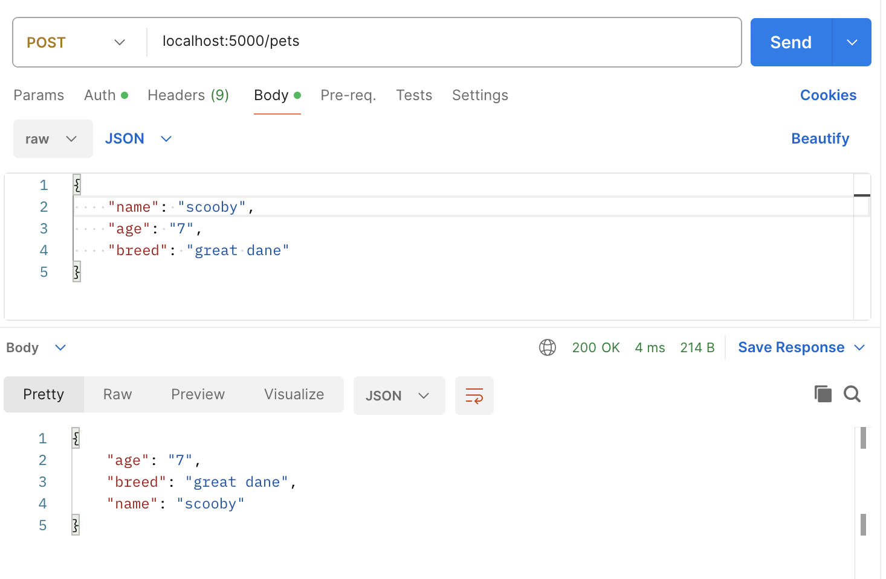

# 

**Learning objective:** By the end of this lesson, students will be able to create a new pet by interacting with the database and sending a JSON response to the client. 

## CREATE - Create route

In this section, we will make a new route to create a new pet. This route will be a `POST` request to `/pets`, and will return a JSON response with the created pet. 

We will be following these specs when building the route: 

- CRUD Action: CREATE
- Method: `POST`
- Path: `/pets`
- Response: JSON
- Success Status Code: 201
- Success Response Body: A new Pet object
- Error Status Code: 500
- Error Response Body: A JSON object with an error key and a message describing the error

## Creating a POST route

The purpose of this route is to handle data that is sent along with a form submission. To access data in the request, we'll need to update our import at the top of our `app.py` file:

```python
from flask import Flask, request
```

Let's create the most basic route possible to print the `request.json` data and return that same object as a response.

```python
@app.route('/pets', methods=['POST'])
def create_pet():
  new_pet = request.json
  print(new_pet)
  return new_pet
```

Testing it with Postman will require setting the "Body" property in the request builder:



## Creating a New Pet in SQL

We need to construct a SQL query using the `request.json` object for inputs.

Of course, when using **any** user input in a SQL statement, we need to protect against SQL Injection by preparing a **parameterized query**.

We can find just such an example in the [psycopg documentation](https://www.psycopg.org/docs/usage.html)

```python
# Pass data to fill a query placeholders and let Psycopg perform
# the correct conversion (no more SQL injections!)
>>> cur.execute("INSERT INTO test (num, data) VALUES (%s, %s)",
...      (100, "abc'def"))
```

Let's include this query in our POST route, including the same connection boilerplate from our index route to get started:

```python
@app.route('/pets', methods=['POST'])
def create_pet():
  try:
    new_pet = request.json
    con = get_db_connection()
    cursor = con.cursor(cursor_factory=psycopg2.extras.RealDictCursor)
    cursor.execute("INSERT INTO pets (name, age, breed) VALUES (%s, %s, %s) RETURNING *", 
                   (new_pet['name'], new_pet['age'], new_pet['breed']))
    created_pet = cursor.fetchone()
    con.commit()
    cursor.close()
    return created_pet, 201
  except Exception as e:
     return str(e), 500
```

Note the need for an explicit `RETURNING *` clause to ensure our SQL statement returns a value we can then send back to the user.

## Test the Route

Let's test the route to ensure that it works - this time, the response should include an `id` property that got added in the SQL database.
