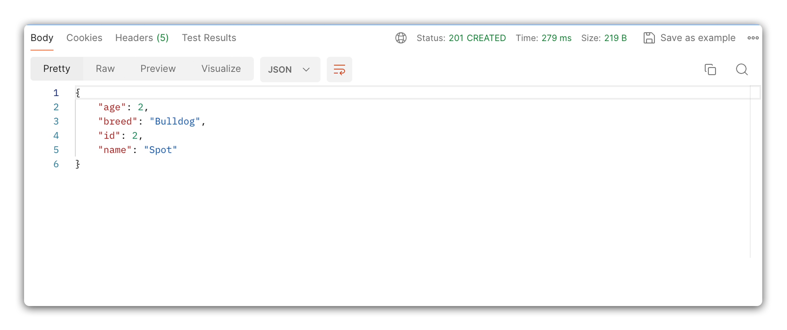

<h1>
  <span class="headline">Pets Back End</span>
  <span class="subhead">Create Route</span>
</h1>

**Learning objective:** By the end of this lesson, students will be able to create a new pet by interacting with the database and sending a JSON response to the client.

## CREATE - Create route

In this section, we will make a new route for creating pet. This route will handle `POST` requests made to `/pets`, and will return a JSON response with the created pet.

We will be following these specs when building the route:

- CRUD Action: CREATE
- Method: `POST`
- Path: `/pets`
- Response: JSON
- Success Status Code: 201
- Success Response Body: A new Pet object
- Error Status Code: 500
- Error Response Body: A JSON object with a message describing the error

## Defining the route

Our `POST` route will be responsible for handling data sent along with a form submission and adding it to our database.

To access this form submission data, we'll need to make use of a Flask `request` object. Flask's `request` object represents the incoming request and allows access to information like headers and form data.

Let's update the existing import at the top of `app.py` to include `request`:

```python
# app.py
from flask import Flask, request
```

Next, we'll make use the `request` object in our route to verify the data submitted by our users. Using `request.json`, we'll `print` the JSON data from the request to our console. Then we’ll return this JSON data as the response to the client.

```python
# app.py
@app.route('/pets', methods=['POST'])
def create_pet():
  new_pet = request.json
  print(new_pet)
  return new_pet
```

In Postman, try submitting a `POST` request to `http://127.0.0.1:5000/pets`. Your Postman request should look something like the example below:


If the request was successful, you should see the form data you submitted issued back as a response.

## Creating a new pet in SQL

Now that we can access the submitted form data, we'll construct our SQL query.

This SQL query will need use the `request.json` object as input. When using **any** user input in a SQL statement, we need to protect against SQL Injection by preparing a **parameterized query**.

We can find just such an example in the [psycopg documentation](https://www.psycopg.org/docs/usage.html):

```bash
# Pass data to fill a query placeholders and let Psycopg perform
# the correct conversion (no more SQL injections!)

>>> cur.execute("INSERT INTO test (num, data) VALUES (%s, %s)",
...      (100, "abc'def"))
```

Let's include this query in our POST route, including the same connection boilerplate from our index route to get started:

```python
@app.route('/pets', methods=['POST'])
def create_pet():
  try:
    new_pet = request.json
    connection = get_db_connection()
    cursor = connection.cursor(cursor_factory=psycopg2.extras.RealDictCursor)
    cursor.execute("INSERT INTO pets (name, age, breed) VALUES (%s, %s, %s) RETURNING *", 
                   (new_pet['name'], new_pet['age'], new_pet['breed']))
    created_pet = cursor.fetchone()
    connection.commit() # Commit changes to the database
    connection.close()
    return created_pet, 201
  except Exception as e:
     return str(e), 500
```

Notice the use of `con.commit()` in the code above. The `.commit()` method is used to ensure that modifications are permanently saved to the database. Be sure to include this when executing create, update, or delete operations.

> 💡 Note the need for an explicit `RETURNING *` clause to ensure our SQL statement returns a value we can then send back to the user.

Once again, test the route using Postman. This time, ensure that the response includes an `id` property. This `id` property lets us know that the data has been added as a new row in the table.


