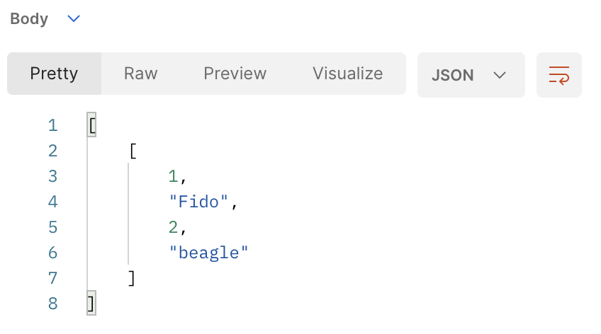
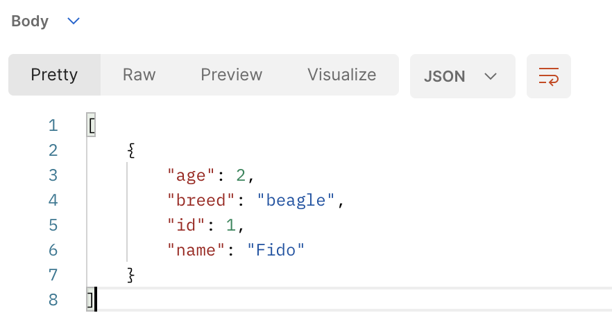

# 

**Learning objective:** By the end of this lesson, students will be able to connect to a SQL Database and make queries from python

## Preparing the Database

Initialize a new database for this project and connect to it:

```sql
CREATE DATABASE pets_db;
\c pets_db;
```

Create a table for our pets data:

```SQL
CREATE TABLE pets(
  id serial PRIMARY KEY,
  name varchar(50) NOT NULL,
  age integer NOT NULL,
  breed varchar(50) NOT NULL
);
```


```sql
INSERT INTO pets (name, age, breed) VALUES ('Fido', 2, 'beagle');
```

Check with a query to confirm the insertion worked as expected:

```SQL
SELECT * FROM pets;
```

## Connecting to PostgreSQL from our Flask app

First, we'll want to install `psycopg2`, a popular postgresql python driver, and `python-dotenv` for storing our connection credentials securely in a `.env` file.

Create the `.env` file and add your local postgres credentials to it, like so:

```
POSTGRES_USER = <your-local-user-name-probably-postgres>
POSTGRES_PASSWORD = your-local-password-for-postgres
```

We can consult the [psycopg documentation](https://www.psycopg.org/docs/usage.html) for basic guidance on connecting to our postgresql database from python.


```python
def get_db_connection():
    conn = psycopg2.connect(host='localhost',
                            database='pets_db',
                            user=os.environ['DB_USERNAME'],
                            password=os.environ['DB_PASSWORD'])
    return conn
```

Let's add our simple SELECT query to the test index route we created earlier:

```python
@app.route('/')
def index():
  con = get_db_connection()
  cursor = con.cursor()
  cursor.execute("SELECT * FROM pets;")
  pets = cursor.fetchall()
  con.commit()
  con.close()
  return pets
```

Testing this route in postman, you should see a result like this:



## Formatting our Data as JSON Responses

So we're getting back a list of lists, without even column names. Not very useful!

We need some code that will structure this SQL response into the expected array of JSON objects that any API is likely to return.

Fortunately, `psycopg2` has a built-in option called `cursor_factory` that lets us define how we expect the results to look.

Simply update the cursor initialization to include a `cursor_factory` option, like so:

```python
cursor = con.cursor(cursor_factory=psycopg2.extras.RealDictCursor)
```

Your response should now be more in line with the conventions of REST API responses:



We're now ready to start defining our RESTful routes for the pets resource!

