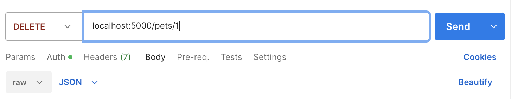
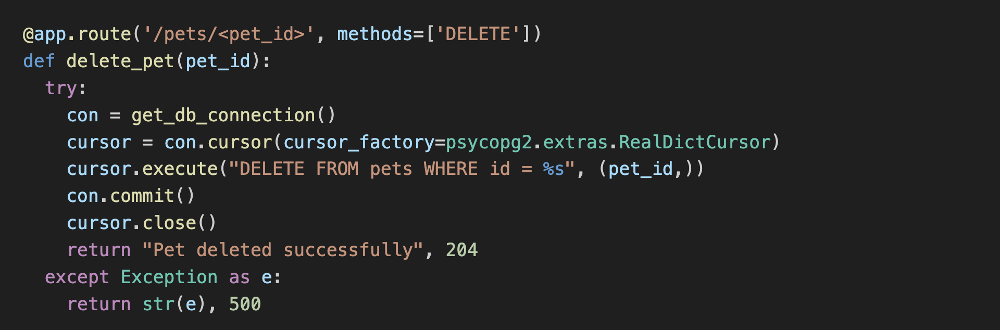

# 

**Learning objective:** By the end of this lesson, students will be able to create a new route to delete a single pet by interacting with the database and sending a JSON response to the client.

## DELETE - Delete Route

In this section, we will create a new route to delete a single pet. This route will be a `DELETE` request to `/pets/<pet_id>`, returning a status of `204` with no content.

We will be following these specs when building the route:

- **CRUD Action:** DELETE
- **Method:** `DELETE`
- **Path:** `/pets/<pet_id>`
- **Response:** No Content
- **Success Status Code:** 204
- **Error Status Code:** 404 || 500
- **Error Response Body:** A JSON object with an `error` key and a message describing the error.

## 🎓 You do: Create a DELETE route

Create a new route to delete a single pet. Using the above specs, create a new route to delete a single pet from the database.

💡 Hints:

- Use the `pet_id` parameter in the route handler function object to access the `pet_id` from the path.
- Use the `DELETE FROM pets WHERE id = ______` SQL query, including a parameter
- You will need a `try...except` block to handle any errors that may occur.
- You can return a simple string message and the status code from this route, such as `return "Pet Deleted Successfully", 204`.
- Make sure to set the status code to `500` and send an error message for any errors that occur.

## Test the delete route with Postman

We have created the route, so let's test it to ensure it works. We'll do this by sending a `DELETE` request to the route using Postman.

Open Postman and create a new request with the following details:

- Use the drop-down menu to select `DELETE` as the method.
- Enter the URL `http://localhost:5000/pets/<pet_id>` in the address bar, where `<pet_id>` is a valid pet id that exists in your database. If you need to create some more pets, use the `Create Route` we built earlier to add them to the database.
- Click the `Send` button to send the request.

### Test for success

After you have sent the request, you should receive a status code of `204` with no content in the response. This means the pet was successfully deleted from the database.

    
Reveal Answer

    

